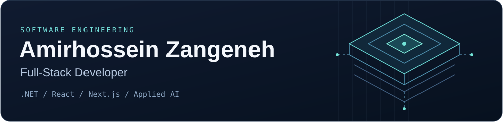

## About

I am a full-stack developer focused on building secure, maintainable web applications with **ASP.NET Core, React, Next.js and TypeScript**.

My interests span backend architecture, reliable APIs, database design, automated testing and applied AI research in computer vision.

## Technology

| Area | Stack |
| :--- | :--- |
| Backend |    |
| Frontend |     |
| Data |    |
| AI & research |   |
| Engineering |    |

## Selected public projects

| Project | Description |
| :--- | :--- |
| [IdentityInvariant-FAS](https://github.com/AmirhosseinZangeneh/IdentityInvariant-FAS) | Research on identity-invariant face presentation attack detection using PyTorch and adversarial representation learning. |
| [AccountingManager-WinForms](https://github.com/AmirhosseinZangeneh/AccountingManager-WinForms) | Layered C# desktop application with SQL Server, repository and unit-of-work patterns, authentication and CI. |
| [Task-Master](https://github.com/AmirhosseinZangeneh/Task-Master) | Responsive Flask task-management application demonstrating CRUD, validation and persistence. |
| [YouTube UI Clone](https://github.com/AmirhosseinZangeneh/youtube-ui-clone) | Educational responsive frontend recreation with accessible controls and theme support. |

## Engineering focus

- Clean Architecture, modular monoliths and domain-driven design
- API design, authentication and authorization
- Relational modeling and automated testing
- Maintainable frontend architecture and responsive interfaces
- Reproducible computer vision experiments

---

**Build with purpose. Engineer for maintainability.**

[Explore my portfolio](https://amirhosseinzangeneh.vercel.app/) · [Get in touch](mailto:amirhossein.zangenehh@gmail.com)

